# 🎅 Moonforged Christmas Decorations

**Moonforged Christmas Decorations** fills your Viking world with festive cheer — glowing trees, sparkling garlands, handmade gifts, sweets, wreaths, stockings, reindeer, and Santa’s own sleigh.  
Every piece has been designed to match Valheim’s atmosphere while adding warmth, color, and celebration to your home.

> **Updated for Valheim 1.0.**  
> The mod project has also been updated to **Unity 6.0.75f1** and refreshed for the current Valheim and Jötunn systems.

---
## 📝 Version 1.0.8

### Sitting Santa 
- Place Sitting Santa on the throne or on the sled.

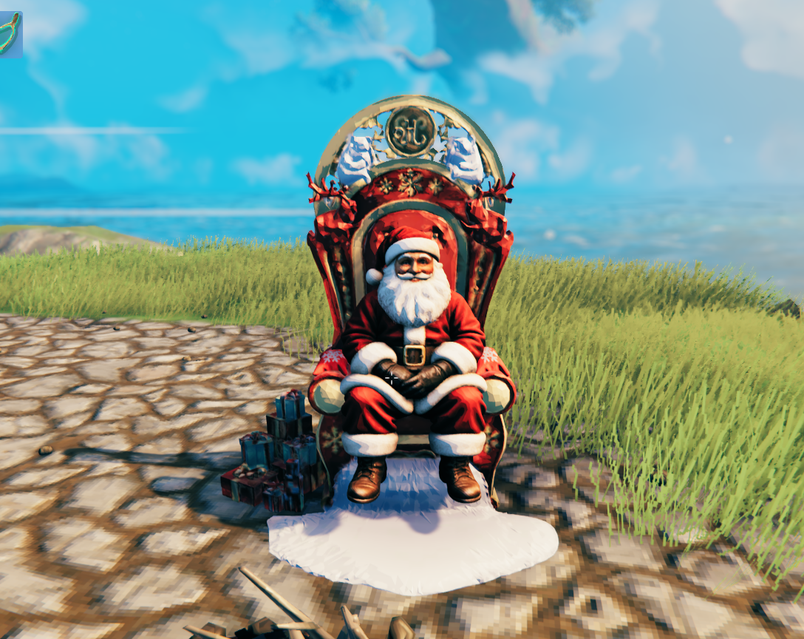

### Revamped Sled
- Added Christmas lights to the sled.

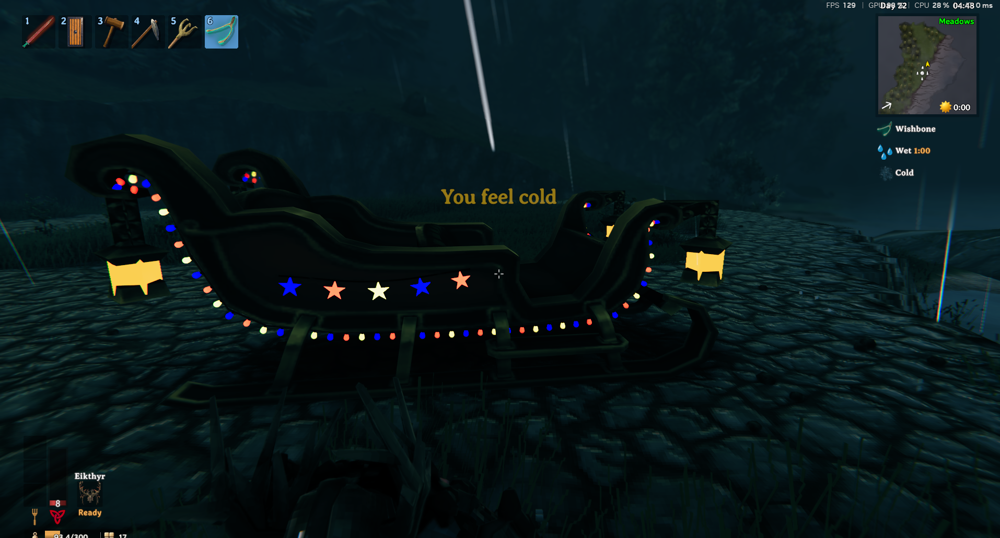

### Revamped Christmas Trees

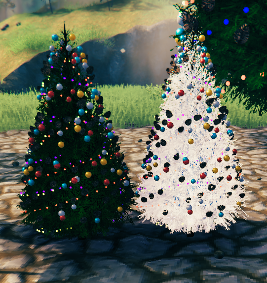

* Added the White Small Christmas Tree.
* Added the Small Cute Snowman.
* Added the Yuletide Elf Boots.
* Added the Wooden Deer Ornament.

### Garland and Tree Lighting

* Remade the Green Christmas Garland and White Christmas Garland with new models and 26 animated bulbs each.
* The two remade garlands and both small Christmas trees now stay lit while smoothly blending through blue, red, yellow, and purple. Each color transition takes 0.9 seconds.
* Brightened the Town Square Christmas Tree and added smooth transitions to its red, yellow, and blue chase.
* Increased bulb emission on the green and white spiral garlands.

---
## 📝 Version 1.0.7

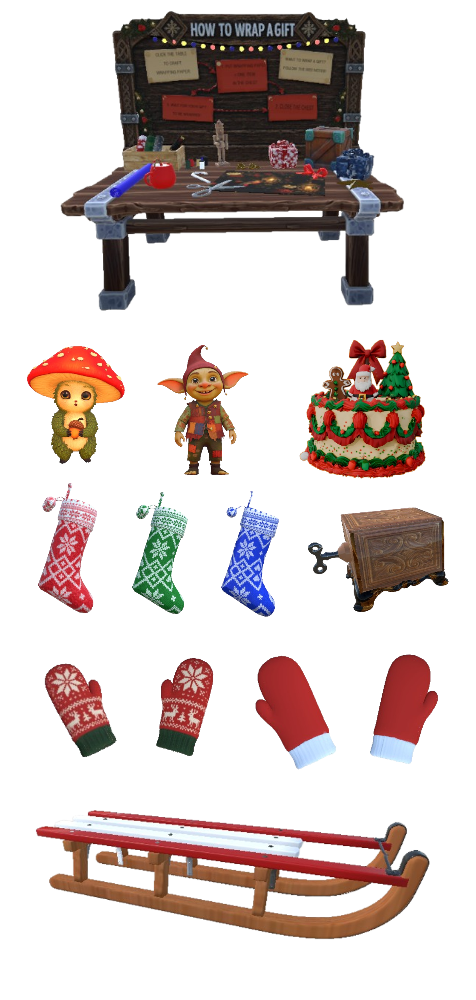

### 🎁 Moonforged Christmas Decorations Tutorial

**Click the image to watch the tutorial on YouTube.**

---

### Compatibility and Wrapping Table Changes

* Updated the mod for Valheim 1.0 compatibility.
* Updated the Unity project to Unity 6.0.75f1 for current Valheim compatibility.
* Updated all interactive decorations for the new Valheim interaction system.
* Added support for the new Valheim build menu. All Christmas decorations are now grouped together under the **Moonforged** category.
* Added a small idle shake animation to the Wrapping Box to make it more noticeable when it is not being used.
* Added a new Wrapping Box completion animation. When a gift is finished, the box jumps slightly into the air, spins 360 degrees, and lands back on the table.
* Improved the Wrapping Table system so items are validated before wrapping materials are consumed.
* Improved Wrapping Box interaction handling and synchronization.
* Improved AssetBundle loading reliability.
* Removed old and unused wrapping and placement code.
* Cleaned and optimized the mod project for the latest Valheim and Jötunn versions. Special thanks to **James Jones** for helping figure this out.
* Updated the Moonforged Christmas Decorations icon.

---

# HOW IT ALL WORKS

## 🎁 Wrapping Table & Gift System

The **Wrapping Table** allows you to wrap almost any item into a festive gift that can be placed, stored, or opened later.

### 🧻 Crafting Wrapping Paper

1. Open the **Wrapping Table**.
2. Each wrapping paper color is crafted **separately**.
3. The wrapping paper color determines the **final gift appearance**.

- Each craft produces **1× Wrapping Paper**.

---

### 📦 Wrapping an Item

1. Open the **Wrapping Box** on the table.
2. Place **exactly two items** inside:
   - **1× Wrapping Paper**
   - **1× item you want to wrap**
3. Close the box.

When the box is not being used, it will occasionally give a small shake to remind you that it is interactive.

While wrapping:

- The box will **blink**.
- The existing **crafting sound** plays.

When wrapping is complete:

- The box makes a small jump.
- It spins **360° around its own axis**.
- It lands back on the table.
- A **gift box** is created.
- The gift color matches the wrapping paper used.

---

### 🎉 Using a Gift

You can:

- Place the gift as a decoration, put it on an **Item Stand**, or **throw it under the tree**.
- Store it in containers.
- **Consume it from your inventory to open it**.

> ⚠ The gift must be opened from your **inventory**, not from the ground.

When opened, the gift restores the original item with its saved information:

- Same stack size.
- Same quality.
- Same durability.
- Same variant.

✔ Safe across game restarts  
✔ Multiplayer & dedicated server safe

---

### ⚠ Important Wrapping Notes

- The Wrapping Box only works with **1 wrapping paper + 1 item**.
- Inventory must have **free space** when opening a gift.
- Each wrapping paper corresponds to a specific gift color.
- The wrapping system now validates the result before consuming the wrapping materials.

---

Enjoy spreading festive surprises! 🎄

---

## 🎄 What You Get

- **Large & Small Christmas Trees** with animated lights.
- **Craftable Star Topper (M_Star)** – made at the Workbench and attachable to any Christmas Tree.
- **Garlands, Wreaths & Mistletoe** for cozy hallways and walls.
- **Icicle Lights, Snowflake Lamps & Town Square Lights** with glowing winter effects.
- **Santa’s Sleigh & Reindeer** – fully rideable and linked by animated reins.
- **Mini Christmas Train** – interactive and rideable.
- **Santa’s Christmas Throne** – sit on the main seat or each armrest.
- **Festive Gifts, Candy Canes, Bows & Stockings**.
- **Yule Sweets & Drinks** – cakes, cocoa, and wine.
- **Nordic Banners, Benches, and Regional Decorations**.
- **Tió de Nadal** regional figure for traditional flavor.
- **Christmas Stained Glass Windows**.
- **Elf Decorations**.
- **Interactive Music Box**.

All Christmas build pieces appear together in the new Valheim build menu under the **Moonforged** category.  
The normal **Materials**, **Recent**, and **Favorites** filters can still be used.

The **gift boxes** and **wrapping paper** are items and do not appear as normal Hammer build pieces.

---

## 🌟 The Evening Star (M_Star)

The **Evening Star** is a special craftable item made at the **Workbench**.

1. Equip it like any placeable item.
2. Approach your Christmas Tree.
3. Look for the **attachment point** at the top.
4. Interact to place your star.

The star glows with animated rainbow light.

---

## 🚂 Interactive Decorations

Several decorations include interactions instead of being purely decorative:

- **Santa’s Sleigh:** Sit inside and ride alongside the reindeer.
- **Christmas Train:** Start or stop the train by interacting with the locomotive. The wagons are rideable while the train circles the track.
- **Animated Lights:** Change their blinking speed and synchronize connected lights of the same type.
- **Music Box:** Interact with it to control its animation and music.
- **Reindeer:** Pet a reindeer and it may sneeze out a **Freeze Gland** as a festive gift.
- **Wrapping Box:** Shakes occasionally while idle and performs a jump-and-spin animation when a gift finishes wrapping.
- **Christmas Stockings:** Store gifts created with the Wrapping Table.

---

## 🪑 Santa’s Christmas Throne (M_Christmas_Throne)

**Santa’s Christmas Throne** is more than a decorative seat — it’s a centerpiece of your festive hall.

- Sit normally on the main throne seat.
- Sit on **each armrest** (left and right) for roleplay, storytelling, or photos.
- Works seamlessly in multiplayer, allowing multiple Vikings to share the throne.

Pair it with banners, garlands, and Christmas trees for a full Yule throne room experience.

---

## 📦 Prefab List

Click to view all prefabs

*(Full list from RelicRegistrar.cs — see the in-game Hammer menu.)*

---

## 🧰 Build Menu

The mod has been updated for Valheim’s new build-menu system.

All Moonforged Christmas build pieces are grouped together under the **Moonforged** category.

You can still use Valheim’s normal filters such as:

- **Materials**
- **Recent**
- **Favorites**

---

## 🧱 How to Install

1. **Install first**
   - BepInEx Pack for Valheim
   - Jötunn (Valheim Library)

2. **Add this mod**
   - Place the `.dll` in:
     `BepInEx/plugins/MoonforgedChristmasDecorations/`

3. **Launch Valheim**
   - All Christmas build pieces will appear in the Hammer build menu under **Moonforged**.

> Valheim 1.0 compatibility and the update to Unity 6.0.75f1 were introduced in version 1.0.6.

---

## 🎁 Future Updates

More decorations, interactions, improvements, and festive surprises are planned!

---

## 📸 Screenshots & Videos

| | | |
|:-:|:-:|:-:|
| 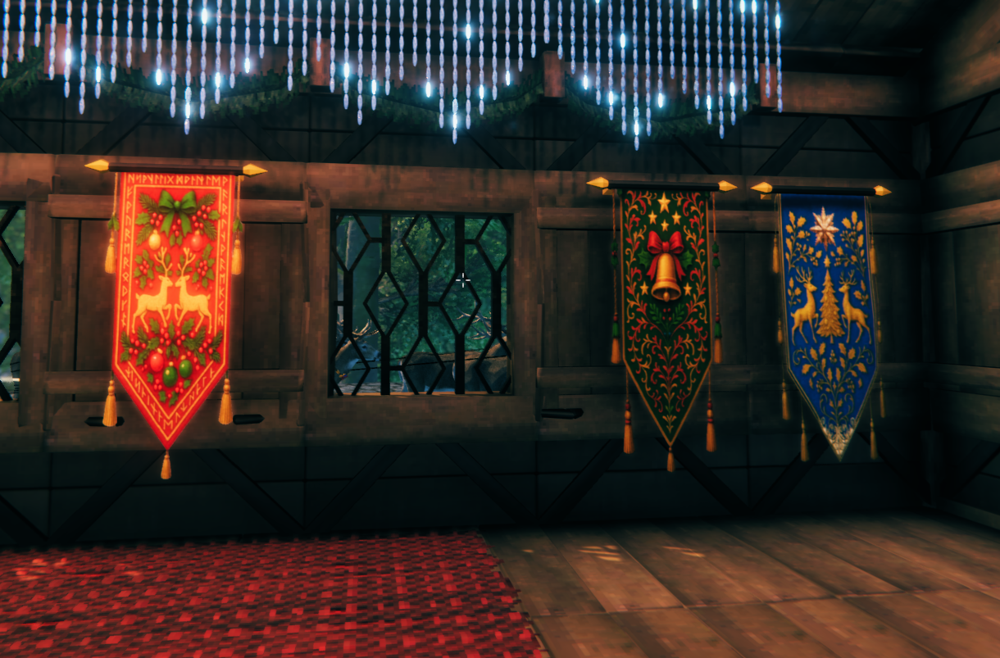 | 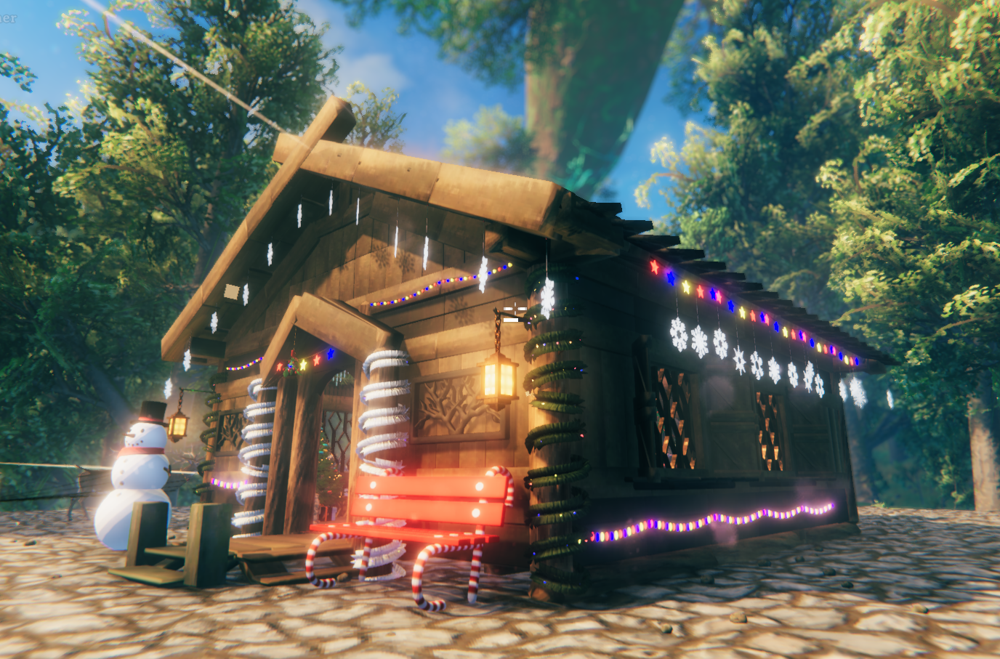 | 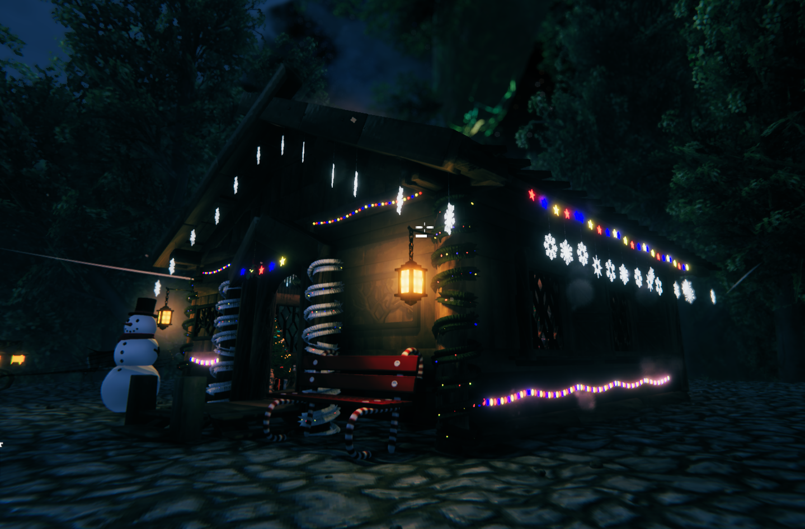 |
| 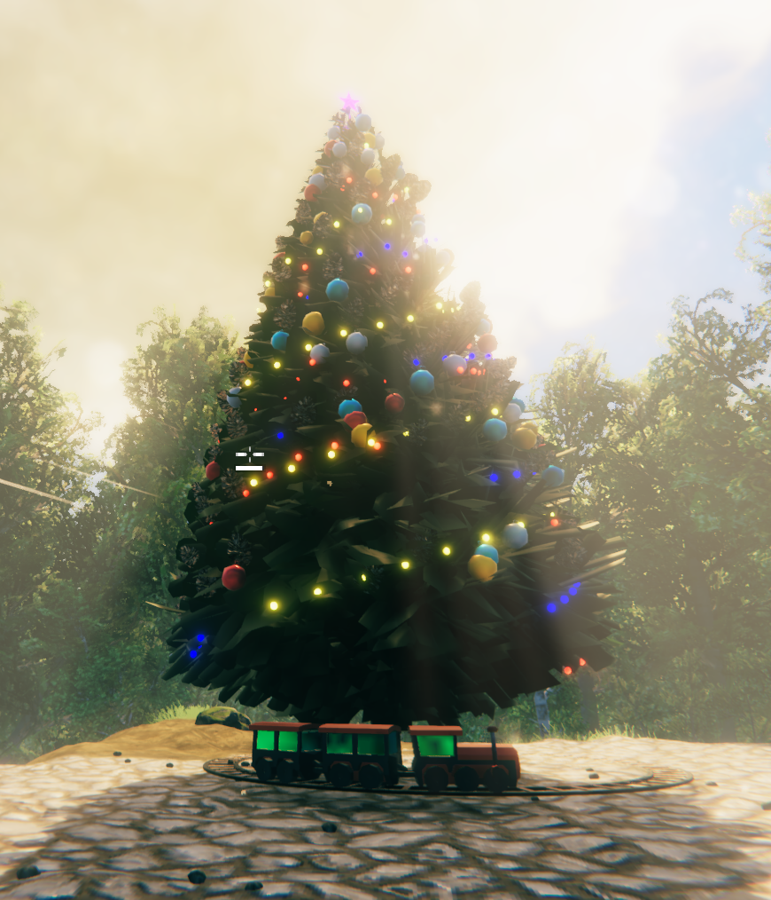 | 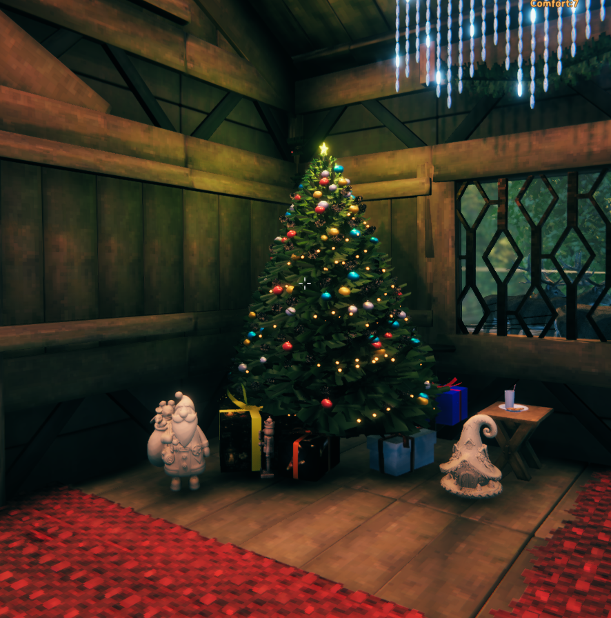 | 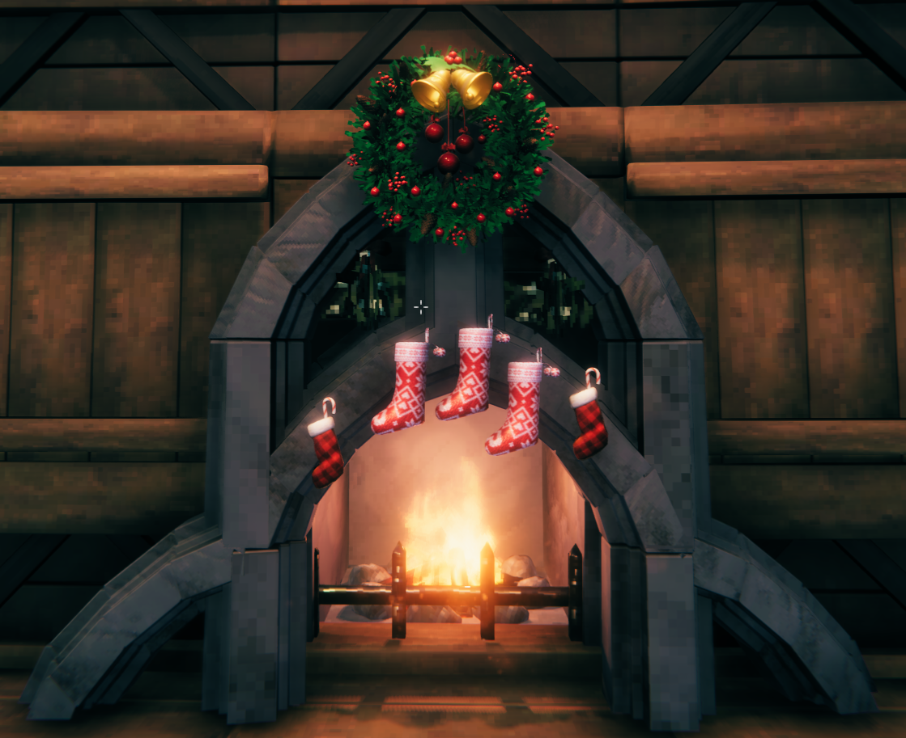 |
| 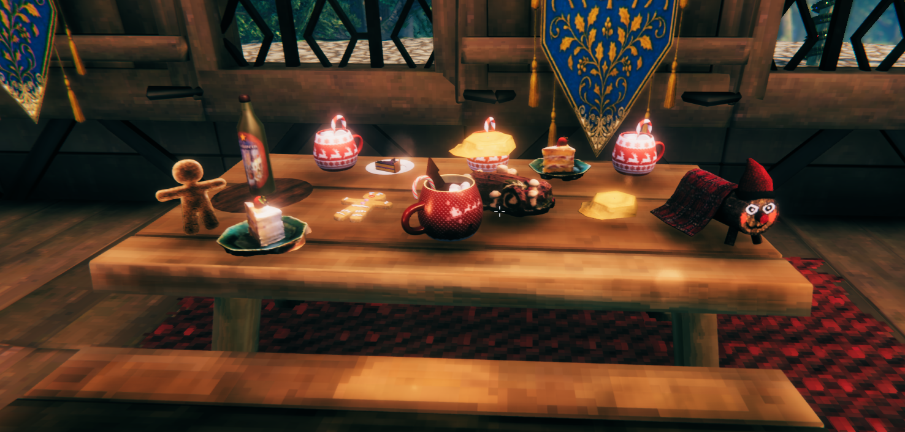 | 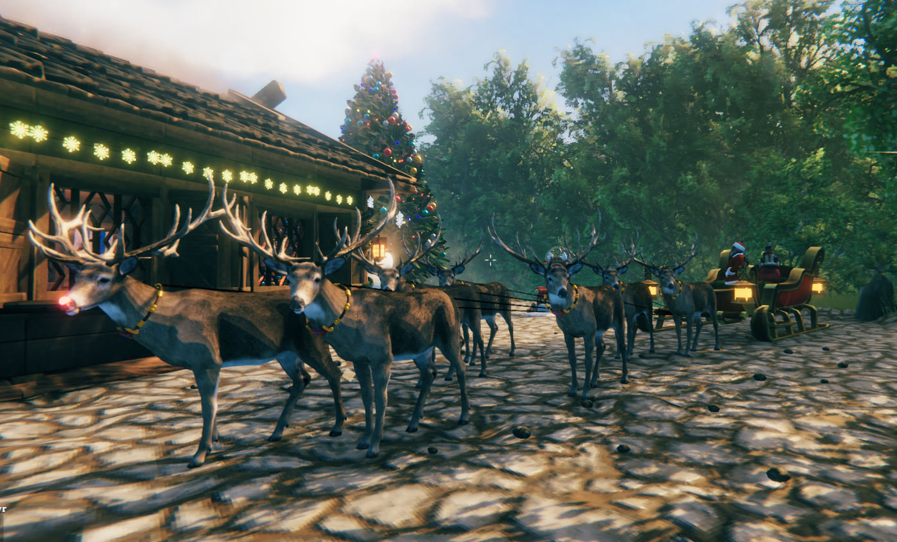 | 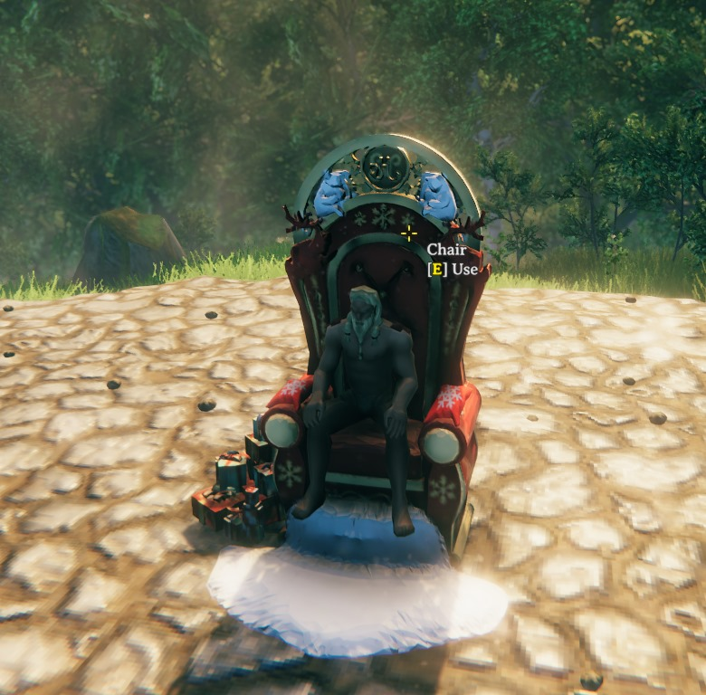 |

### 🪑 Throne Sitting Showcase

| | |
|:-:|:-:|
| 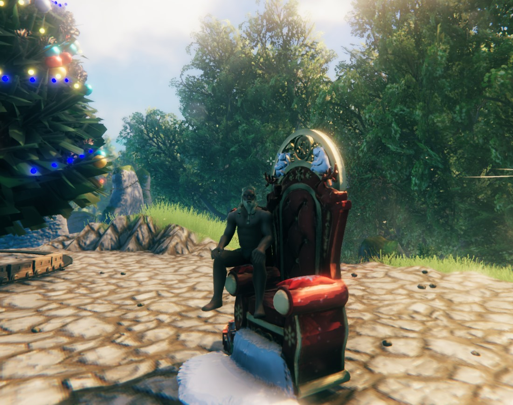 | 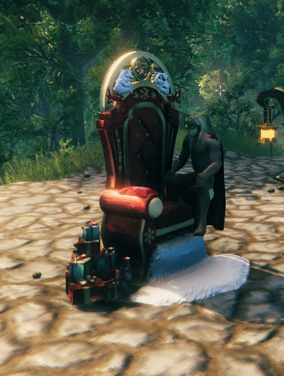 |

### 🪟 Stained Glass Windows

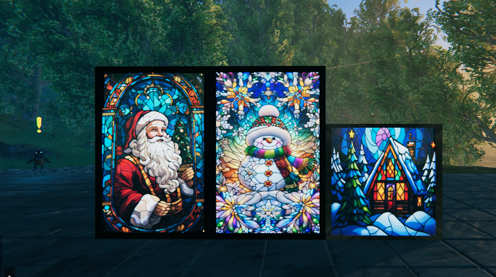

### 🎁 Moonforged Christmas Decorations Tutorial

[Watch the full mod tutorial on YouTube](https://www.youtube.com/watch?v=NohmUO9-JYw)

---

# 📝 Credits & Feedback

- Made by **Caenos**
- Join the community on [Discord](https://discord.gg/nw7kkC2Ega) for feedback, support, and sneak peeks.
- If the invite link expires, you can also find me in the Thunderstore or Valheim Discord communities.
- Watch live on **Twitch**: [https://www.twitch.tv/Caen007](https://www.twitch.tv/Caen007) .
- Videos and tutorials on **YouTube**: [https://www.youtube.com/@Caenos007](https://www.youtube.com/@Caenos007) .
- Join the discussion on **Reddit**: [Modded Valheim Discussion](https://www.reddit.com/r/ModdedValheim/comments/1vw3n30/comment/p5dtktq/?screen_view_count=2&ext-referrer=DIRECT) .
- Support the project: 💖 [PayPal](https://www.paypal.com/paypalme/Caenos) .

### Planned Features
- When you approach the new Santa, he’ll wave, put his hands on his belly, and say, “Ho ho ho! Merry Christmas!”
- Any rideable creature in Valheim will be able to pull the sled.
- The Christmas Bell will play a random Christmas carol when you interact with it. 
---

## 🎄 Special Thanks

- **The Undertaker**

--- 
**I made this mod for a friend I’ll never forget.**

---

Warm your hall, light the candles, and celebrate Yule with the Moonforged family.  
**Merry Christmas, Vikings!**
